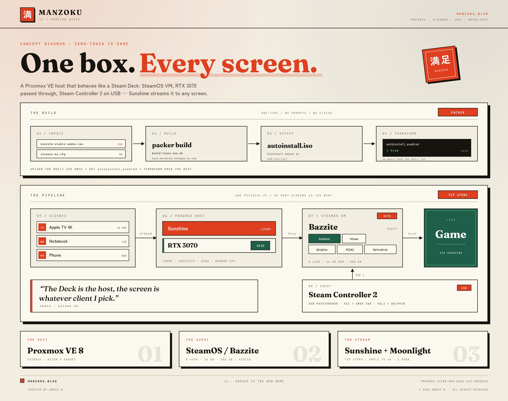

# proxmox-steam-gpu-mosu-sc2-emudeck

Proxmox VE + SteamOS + GPU passthrough + Steam Controller 2 + Moonlight + Sunshine (MOSU) + EmuDeck.

One homelab box. One repo.

Author: **Arwid**
Blog: **https://manzoku.blog**

## What this is

This repo takes my Proxmox box and turns it into a Steam Deck replacement.

The idea:

- Proxmox host runs everything.
- A SteamOS VM runs the games.
- The NVIDIA GPU lives on the host, gets passed into the VM.
- A Steam Controller 2 plugs straight into the VM.
- Games run on the passed through GPU.
- Other screens just stream in over the network, via Sunshine + Moonlight.

So one physical PC, but as many screens as I want. The Deck is the host, the
screen is whatever client I pick.

## What's in this repo

- `main.tf` - creates the SteamOS VM on the Proxmox node, GPU passthrough, controller passthrough
- `packer/steamos-autoinstall.pkr.hcl` - builds a Bazzite ISO with the kickstart baked in, for the unattended install
- `scripts/setup-host-vfio.sh` - enables IOMMU / VFIO on the Proxmox host
- `scripts/concept-diagram/` - editable source for the concept diagram (`make_concept.py` + font fetch)
- `scripts/install-gaming-services.sh` - installs Moonlight + Sunshine + EmuDeck inside the SteamOS VM
- `terraform.tfvars.example` - values I need to fill in before first apply
- `templates/sc2-controller/` - SC2 -> Xbox 360 controller setup templates (sdl2 + dolphin) for EmuDeck integration
- `templates/steamos-steam-account.template` - SteamOS Steam account auto-config for added account + gamepad setup

## Hardware this was built around

- Proxmox VE on ASRock X570D4U, AMD Ryzen 9 5900XT
- NVIDIA GeForce RTX 3070, passed through to the VM
- Steam Controller 2
- SteamOS VM (Bazzite), 8 cores, 16 GB RAM, 500 GB disk

## How it fits together



Diagram source is editable: `scripts/concept-diagram/` (rebuild with
`python3 scripts/concept-diagram/make_concept.py`).

```
Moonlight client ──> Sunshine on Proxmox host ──> GPU passed through ──> SteamOS VM ──> game
                          (port 47989)
```

Install side, unattended:

```
Bazzite ISO + kickstart ──> packer build ──> autoinstall ISO ──> terraform cdrom ──> VM boots hands-free
```

Sunshine runs on the host and reads the GPU directly. Moonlight on the client
just asks Sunshine for a stream.

## Setup

Step by step, from zero.

1. **Host.** Proxmox host with IOMMU + VFIO ready, NVIDIA GPU installed, Steam
   Controller 2 plugged in. Run the VFIO script on the host, put in your GPU ids,
   reboot.

```bash
sudo bash scripts/setup-host-vfio.sh
```

2. **ISO.** Put the SteamOS image (Bazzite) on the Proxmox ISO storage, if not
   there yet.

```bash
scp bazzite-stable-amd64.iso root@<proxmox-host>:/mnt/hdd-iso/template/iso/
ssh root@<proxmox-host> "pvescan"
```

Unattended path (WIP): `cd packer && packer build steamos-autoinstall.pkr.hcl`
bakes the kickstart into the ISO (input: `packer/iso/bazzite-stable-amd64.iso`),
then upload `packer/output/bazzite-autoinstall.iso` and set
`autoinstall_enabled = true` so Terraform boots that ISO instead. Still needs
`scripts/build-linux-iso.sh` and `autoinstall/kickstart/steamos-ks.cfg`, which
are not in the repo yet.

3. **Terraform.** Clone, init, fill tfvars, apply.

```bash
git clone <repo-url>
cd proxmox-steam-gpu-mosu-sc2-emudeck
terraform init
cp terraform.tfvars.example terraform.tfvars
# fill in: proxmox token, proxmox_host, gpu ids, controller id

terraform apply
```

Terraform creates the VM, starts it, waits for IP, runs install script
(EmuDeck + Sunshine + Moonlight).

4. **Open the port.** Fritzbox: 47989 TCP → Proxmox host.

5. **Play.** Moonlight client → Sunshine on host → GPU → SteamOS VM → game.
   Controller in via USB.

6. **Tested.** Moonlight on Apple TV 4K, two controllers, two-player Wii games.

## Ports

- Sunshine (Moonlight backend) listens on **TCP 47989**.
- Fritzbox: port forward **47989 TCP → Proxmox host** (`<proxmox-host>`).
- No other ports needed for this setup (GPU passthrough, controller, EmuDeck).

## Audio (Apple TV 4K)

When streaming Moonlight -> Sunshine -> GPU -> SteamOS VM -> TV, sound should
come out over the Apple TV 4K directly.

Check:
- Apple TV: Settings -> Sound -> Audio Output -> Apple TV 4K
- Moonlight: audio from stream, output to TV

No extra template needed. If no sound, check Moonlight audio track + Apple TV
output. Sunshine audio goes with the stream from the GPU.

## Example GPU setup

```text
hostpci0:
  device   = "hostpci0"
  id       = "0000:01:00.0;0000:01:00.1"
  mapping  = "nvidia-gpu"
  rombar   = false
  xvga     = true
```

Mediated device example: `mdev0.1`.

## Notes

- EmuDeck is installed in the VM for emulated consoles (Dolphin, PCSX2, RetroArch).
- VM uses machine type `pc` (i440fx). Q35 broke the NVIDIA driver on this host, do not switch.
- GPU functions (card + audio) must be in the same IOMMU group, otherwise passthrough fails.
- Steam Controller 2 goes in via USB passthrough. Bluetooth is not passed through.
- Sunshine default port is 47989, adjust if you changed it.
- Steam games like Squad do not run under a VM — for that they need a standalone single OS without hypervisor.
